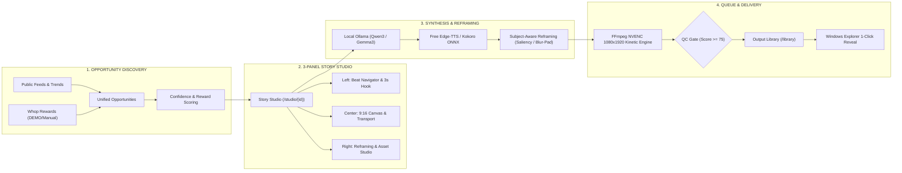

# LocalShorts Studio (`v0.2.0` — Obsidian Studio)

<p align="center">
  
  
  
  
  
  
  
  
</p>

> **Local-First Creator Production Studio**  
> *A professional editorial suite combining Whop Content Rewards clipping workflows, a 3-panel Story Studio, rights-and-relevance visual pipelines, and a Google Stitch-driven design system. Produces ready-to-upload 1080×1920 YouTube Shorts, TikToks, and Instagram Reels automatically on consumer Windows laptops with zero recurring subscriptions.*

---

## 📑 Table of Contents

1. [Executive Summary & Product Philosophy](#-executive-summary--product-philosophy)
2. [Google Stitch Design Architecture (Obsidian Studio)](#-google-stitch-design-architecture-obsidian-studio)
3. [Zero Mandatory Subscriptions](#-zero-mandatory-subscriptions)
4. [Core Features & Production Workflows](#-core-features--production-workflows)
   - [1. Discover & Whop Content Rewards Engine](#1-discover--whop-content-rewards-engine)
   - [2. Three-Panel Story Studio (`/studio/{job_id}`)](#2-three-panel-story-studio-studiojob_id)
   - [3. High-Efficiency Production Queue](#3-high-efficiency-production-queue)
   - [4. Output Library & Explorer Integration](#4-output-library--explorer-integration)
   - [5. ChatGPT Plus Asset Hub (User-Mediated)](#5-chatgpt-plus-asset-hub-user-mediated)
   - [6. Free Online Neural Voiceovers (Edge-TTS) & 4-Tier Audio Chain](#6-free-online-neural-voiceovers-edge-tts--4-tier-audio-chain)
   - [7. Local Scripting & 3-Way Originality Gate](#7-local-scripting--3-way-originality-gate)
   - [8. Kinetic Typography & FFmpeg NVENC Engine](#8-kinetic-typography--ffmpeg-nvenc-engine)
5. [Hardware Profiles & Laptop Safety Guardrails](#-hardware-profiles--laptop-safety-guardrails)
6. [Quickstart Guide](#-quickstart-guide)
7. [Keyboard Shortcuts & Command Palette](#-keyboard-shortcuts--command-palette)
8. [Project Structure](#-project-structure)
9. [REST API Reference](#-rest-api-reference)
10. [Automated Testing & Visual Verification](#-automated-testing--visual-verification)
11. [Troubleshooting & FAQ](#-troubleshooting--faq)
12. [License & Attributions](#-license--attributions)

---

## 🎯 Executive Summary & Product Philosophy

LocalShorts Studio is **NOT** an enterprise admin dashboard, infrastructure-monitoring dashboard, or generic AI SaaS wrapper. It is built as a **CREATOR PRODUCTION STUDIO** centered on:

### **THE STORY / THE VIDEO / THE CAMPAIGN**

Technical telemetry (GPU temp, VRAM, queue counts) exists unobtrusively in a compact status badge, while **100% of the screen geometry is dedicated to creative decision-making**:
- **0% Generative AI Video Hallucinations**: Zero dependency on slow, expensive cloud video models (Sora, Runway, Veo). Instead, the system pairs verified real-world assets (ChatGPT search, Wikimedia Commons, Pexels, CC-BY news media) with procedural motion plates, kinetic typography, and synchronized sound effects.
- **Whop Content Rewards Ready**: Directly indexes and organizes creator clipping campaigns with budget tracking, CPM, deadline indicators, submission links, and content rule compliance checklists.
- **Desktop-First Ergonomics**: Designed for real creative work on laptops and multi-monitor workstations across `1366×768`, `1440×900`, `1920×1080`, and `2560×1440` with zero dead space.



---

## 🎨 Google Stitch Design Architecture (Obsidian Studio)

The user interface was generated and architected through **Google Stitch** (`STITCH_ACTIVE`, Project `5588442246823867498`, Screen `dc26cacb3ccd4997b81a562618963102`). The design system—termed **Obsidian Studio**—delivers a dark editorial minimalist aesthetic tailored for prolonged creative focus:

### Modular CSS Structure
```
src/localshorts/ui/static/css/
├── tokens.css        # Core design tokens (Obsidian color palette, typography, elevation, motion)
├── layout.css        # Responsive app shell (220px fixed rail, compact header, scroll containers)
├── components.css    # Reusable studio UI primitives (cards, badges, modals, command palette)
└── studio.css        # 3-panel Story Studio, 9:16 vertical canvas, beat timeline, reframing tools
```

### Design Token Specification
| Token Category | Variable Name | Value / Specification | Role in UI |
| :--- | :--- | :--- | :--- |
| **Canvas Background** | `--color-bg-base` | `#0b0f17` | Deep Obsidian background, reducing eye strain |
| **Card Surface** | `--color-bg-surface` | `#121826` | Elevated cards, panels, and navigation rails |
| **Active Overlay** | `--color-bg-elevated`| `#1a2236` | Modals, dropdowns, and focused items |
| **Primary Accent** | `--color-accent` | `#38bdf8` (Cyan Neon) | Active states, primary CTAs, playback scrubbers |
| **Secondary Accent**| `--color-accent-alt`| `#818cf8` (Indigo) | Topic pills, campaign badges, secondary actions |
| **Success / QC Pass**| `--color-success` | `#10b981` (Emerald) | QC score $\ge 75$, ready state, audio match |
| **Hook / Attention** | `--color-warning` | `#f59e0b` (Amber Gold)| 3-second hook callout, high-priority opportunities |
| **Border Subtlety** | `--color-border-subtle`| `rgba(255,255,255,0.08)` | Crisp, ultra-fine 1px editorial panel dividing borders |
| **Typography** | `--font-sans` | `Barlow, system-ui, -apple-system` | Legible, high-density editorial tracking |

---

## 💰 Zero Mandatory Subscriptions

LocalShorts Studio replaces expensive cloud SaaS subscriptions with high-performance local and free-tier technologies:

| SaaS Service | Typical Monthly Cost | LocalShorts Studio Replacement | Studio Monthly Cost |
| :--- | :--- | :--- | :--- |
| **ElevenLabs / Paid TTS** | $22 – $99 / mo | **Free Edge-TTS** (8 Studio Neural Voices) + **Kokoro ONNX** | **$0.00 (Free)** |
| **OpenAI / Claude API** | $20 – $100 / mo | **Local Ollama** (`qwen3:4b`, `gemma3:4b`) | **$0.00 (Free)** |
| **CapCut Pro / Revid / Virlo**| $30 – $60 / mo | **FFmpeg NVENC 1080×1920 Kinetic Typography Engine** | **$0.00 (Free)** |
| **Runway / Sora Video Gen** | $35 – $95 / mo | **Procedural Motion Plates + ChatGPT Plus Asset Hub** | **$0.00 (Free)** |
| **Trend / Opportunity Scrapers**| $49 / mo | **Public RSS + Google Trends + Whop Content Rewards** | **$0.00 (Free)** |
| **Total Monthly Burn** | **$156 – $403 / mo** | **Your Windows PC + Electricity** | **$0.00 / mo** |

---

## 🚀 Core Features & Production Workflows

### 1. Discover & Whop Content Rewards Engine
Accessible at `/discover` (and default `/`):
- **Unified Opportunity Model**: Merges live web trend spikes with Whop Content Rewards clipping campaigns into a clean, actionable editorial feed.
- **Curated Whop Campaigns**: Out of the box, provides realistic reference campaigns explicitly labeled with **`DEMO: True`** (e.g., *SaaS Productivity Clip Challenge*, *AI Creator Tools Showcase*, *Crypto Alpha Moments*).
- **Manual Campaign Import**: Paste brief text or campaign URLs directly into the **Manual Import Modal**. The built-in parser extracts:
  - Reward pool (`$1,500`) and CPM rate (`$12.00 / 1K views`)
  - Campaign deadline and target platforms (YouTube Shorts, TikTok, Reels)
  - Required hashtags and submission URLs
  - Mandatory rules and forbidden phrases
- **1-Click Clip Action**: Clicking **"Clip This Opportunity"** pre-fills the pipeline with brand guidelines, optimal hook formulas, and targeted asset queries.

### 2. Three-Panel Story Studio (`/studio/{job_id}`)
The flagship workstation for perfecting shorts before final export:
- **Left Panel — Story Beat Navigator**:
  - Sequential beat timeline showing duration, spoken lines, and keyword tags.
  - **First 3-Second Hook Callout**: Prominently highlights the retention hook with character count and emotional delivery cue.
- **Center Panel — 9:16 Vertical Video Canvas**:
  - Exact 1080×1920 mobile viewport simulation with live video playback, timecode (`00:08 / 00:27`), and responsive playback transport (`Play/Pause`, `Step Beat -5s`, `Step Beat +5s`).
  - Overlay kinetic subtitle preview synchronized to narration beats.
- **Right Panel — Scene Inspector & Asset Studio**:
  - **Subject-Aware Reframing**: Choose per-scene framing modes:
    - *Smart Crop*: Saliency/entropy detection centers the visual focal point.
    - *Contain + Blur Pad*: Pads horizontal media with a soft Gaussian-blurred backdrop.
    - *Manual Focal Point*: Precision positioning coordinates.
  - **Confidence Breakdown**: 0–100 scores for Asset Relevance, Rights Safety, and Source Credibility.
  - **Asset Replacement Drawer**: Drag and drop local images/videos directly onto a beat to swap assets instantly.
  - **Per-Stage Regeneration Controls**: 1-click surgical buttons to regenerate *Script*, *Voice*, *Captions*, *Visuals*, or *Re-Render MP4* without re-running the entire job.

### 3. High-Efficiency Production Queue (`/queue`)
- **Default High-Efficiency List View**: Dense, data-rich table displaying Title, Target Platform, Stage Progress, Quality Score, and Actions. Retains user preference via `localStorage` (switchable to Whop 9:16 Grid View anytime).
- **Human-Readable Stage Badges**: Clearly reflects pipeline state:
  `Researching` → `Drafting Script` → `Synthesizing Voice` → `Aligning Beats` → `Reframing Media` → `Encoding NVENC` → `Quality QC` → `Ready`.
- **Quality Score Pill (0–100)**: Aggregates Hook Strength (30%), Audio Loudness & Clarity (25%), Kinetic Pacing (25%), and Visual Diversity (20%).
- **Quick Handoff**: 1-click **"Open Studio"** jumps straight into the 3-panel workspace for any active or completed job.

### 4. Output Library & Explorer Integration (`/library`)
- **Ready-to-Upload Gallery**: Visual cards for every completed Short featuring:
  - Native video player with fallback poster plates.
  - Verified duration, aspect ratio (1080×1920), and QC score badge.
- **Native Windows Explorer Containment**:
  - **"Open Ready-to-Upload Folder"**: Opens `output/ready-to-upload/` directly in File Explorer.
  - **"Open Job Folder"**: Opens the complete project directory (`output/YYYY-MM-DD/{slug}/`) containing master audio, ASS subtitles, scene assets, and raw FFmpeg logs.
  - **"Highlight File"**: Launches Windows Explorer with `/select,<path>`, immediately selecting the target `.mp4` file for fast drag-and-drop into YouTube Studio.
  - **"Copy Path"**: Copies the absolute local path to clipboard.

### 5. ChatGPT Plus Asset Hub (User-Mediated)
Leverages your existing ChatGPT Plus subscription (Web Search & DALL-E 3) without brittle automated scraping or risking account bans:
1. Studio generates a structured visual prompt detailing each scene timestamp, visual query, and subject description.
2. User copies prompt with 1 click (`Ctrl+C`) and pastes into ChatGPT Plus.
3. User pastes ChatGPT's output or image URLs back into LocalShorts Studio.
4. Studio auto-downloads media, verifies aspect ratio, applies blur-padding or smart cropping, and automatically triggers an instant re-render.

### 6. Free Online Neural Voiceovers (Edge-TTS) & 4-Tier Audio Chain
No paid ElevenLabs keys required:
- **8 Microsoft Studio Voices**: High-definition, natural phrasing:
  - `en-US-ChristopherNeural` (Deep, authoritative documentary default)
  - `en-US-GuyNeural` (Punchy creator & tech explainer)
  - `en-US-JennyNeural` (Friendly conversational)
  - `en-US-AriaNeural` (Expressive narrative)
  - `en-US-EricNeural` (Casual explainer)
  - `en-GB-RyanNeural` (British documentary)
  - `en-GB-SoniaNeural` (British journalistic)
  - `en-AU-WilliamNeural` (Australian narrator)
- **4-Tier Fallback Chain**: `Edge-TTS` (Online) $\to$ `Kokoro ONNX` (Offline 82M) $\to$ `Windows SAPI` $\to$ `Procedural DSP`.
- **Procedural Sound Design**: Includes 5 mathematically synthesized CC0 sound effects (`impact.wav`, `whoosh.wav`, `pop.wav`, `click.wav`, `riser.wav`), audio ducking, and `-14 LUFS` EBU R128 normalization.

### 7. Local Scripting & 3-Way Originality Gate
- **Ollama Engine**: Integrates locally with `qwen3:4b`, `gemma3:4b`, or `qwen2.5:1.5b`.
- **55–80 Word Bounds**: Guarantees concise 22–32 second videos for maximum completion rate.
- **Banned Intro Filter**: Strips weak creator clichés (*"Hey guys", "Did you know that...", "In this video"*).
- **3-Way Originality Verification**:
  1. RapidFuzz Token Sort / Levenshtein Distance
  2. 3-Gram Jaccard Set Overlap
  3. Scikit-Learn TF-IDF Cosine Similarity  
  *Scripts with $> 0.78$ similarity to source content are automatically rejected and regenerated.*

### 8. Kinetic Typography & FFmpeg NVENC Engine
- **Hardware NVENC**: Hardware-accelerated H.264 video encoding via `h264_nvenc` with automatic, seamless fallback to CPU `libx264`.
- **Kinetic Subtitles**: Word-level ASS/SRT subtitles with highlighted keywords (Yellow, Cyan, Emerald), text outlines, and drop shadows using SIL OFL fonts (`Barlow Condensed`, `Archivo Black`).
- **Comprehensive QC Inspector**: Validates container integrity, stream duration, non-blank frames, AAC audio presence, and subtitle sync before marking ready.

---

## 💻 Hardware Profiles & Laptop Safety Guardrails

LocalShorts Studio dynamically inspects hardware on boot and applies thermal-conscious profiles:

| Profile | Target Hardware | Max Jobs | Context | Video Encoder | TTS Engine |
| :--- | :--- | :--- | :--- | :--- | :--- |
| **LIGHTWEIGHT** | $\le 8\text{ GB}$ RAM, Integrated GPU | 1 | 2048 | CPU `libx264` | Windows SAPI / DSP |
| **BALANCED** *(Default)* | **16 GB RAM, 4 GB VRAM (RTX 3050 Ti)** | **1** | **4096** | **`h264_nvenc` (CPU fallback)** | **Edge-TTS / Kokoro** |
| **PERFORMANCE** | $\ge 32\text{ GB}$ RAM, $\ge 8\text{ GB}$ VRAM | 1 | 8192 | `h264_nvenc` | Edge-TTS / Kokoro |

### 🛡 Laptop Protection Safeguards
1. **Thermal Guard**:
   - `< 80°C`: Normal sequential processing.
   - `80°C – 85°C`: Inserts an automatic 10-second thermal rest period between queue jobs.
   - `> 85°C`: Immediately pauses queue execution until the GPU cools down below 80°C.
2. **Battery Guard**: Automatically pauses batch rendering when unplugged from AC power to prevent thermal throttling and sudden battery drain.
3. **VRAM Collision Prevention**: Ollama LLM is explicitly unloaded (`keep_alive: 0`) before FFmpeg GPU encoding starts, avoiding VRAM crashes on 4 GB laptop GPUs.

---

## 🚀 Quickstart Guide

### Prerequisites
1. **Windows 10 / 11 x64**
2. **Python 3.11** installed and added to `PATH`
3. **Ollama** installed and running:
   ```powershell
   ollama serve
   ollama pull qwen3:4b
   ```
4. **NVIDIA Graphics Driver** (optional, enables fast NVENC encoding)

### One-Click Launch
In the repository root, run:
```cmd
START_LOCAL_SHORTS.bat
```
*Bootstraps the virtual environment (`.venv`), installs dependencies, validates FFmpeg binaries, launches the server at `http://127.0.0.1:8765`, and opens your default browser.*

### Running System Diagnostics
```cmd
DIAGNOSTICS.bat
```
Runs a 15-point verification suite:
- [x] Python virtual environment & packages
- [x] FFmpeg and ffprobe presence
- [x] NVENC acceleration & CPU fallback
- [x] Ollama API & model readiness
- [x] Edge-TTS & Kokoro synthesis
- [x] SQLite WAL database
- [x] Sound effects & kinetic fonts
- [x] End-to-end 4.2s 1080×1920 test render with QC pass

---

## ⌨️ Keyboard Shortcuts & Command Palette

| Shortcut | Scope | Action |
| :--- | :--- | :--- |
| <kbd>Ctrl</kbd> + <kbd>K</kbd> / <kbd>Cmd</kbd> + <kbd>K</kbd> | Global | Open Obsidian Command Palette |
| <kbd>Esc</kbd> | Global | Close active modal, drawer, or palette |
| <kbd>Space</kbd> | Story Studio | Play / Pause 9:16 Canvas Video |
| <kbd>J</kbd> | Story Studio | Step backward 1 beat (-5s) |
| <kbd>L</kbd> | Story Studio | Step forward 1 beat (+5s) |
| <kbd>R</kbd> | Story Studio | Quick-trigger Re-render |

---

## 📁 Project Structure

```
localshorts-studio/
├── .venv/                              # Python 3.11 virtual environment
├── assets/
│   ├── fonts/                          # SIL OFL kinetic caption fonts (Barlow, Archivo)
│   └── sfx/                            # CC0 procedural sound effects (impact, whoosh, pop, etc.)
├── bin/                                # Portable binaries (ffmpeg.exe, ffprobe.exe)
├── cache/                              # Cached media plates and stock downloads
├── data/
│   ├── localshorts.db                  # SQLite database in WAL mode
│   └── hardware_snapshot.json          # Hardware profile and thermal calibration
├── docs/
│   └── ui/                             # Visual verification screenshots across 4 viewports
│       ├── before/                     # Baseline UI captures (24 files)
│       └── after/                      # Obsidian Studio redesign captures (28 files)
├── output/
│   ├── YYYY-MM-DD/{slug}/              # Full project archives (video, audio, ASS, logs)
│   └── ready-to-upload/                # QC-approved 1080×1920 MP4 exports
├── src/localshorts/
│   ├── api/                            # FastAPI REST API routers
│   │   ├── campaigns.py                # Whop campaign discovery, import & save
│   │   ├── generation.py               # Job dispatch & regeneration triggers
│   │   ├── health.py                   # System telemetry & hardware monitor
│   │   ├── library.py                  # Ready-to-upload gallery & Explorer reveal
│   │   ├── settings.py                 # User preferences & profile settings
│   │   ├── trends.py                   # RSS scraping & trend clustering
│   │   └── views.py                    # Discover, Studio, Queue, and Settings views
│   ├── models/                         # Domain schemas & database entities
│   │   ├── db_models.py                # SQLModel tables (Job, ContentOpportunity, etc.)
│   │   └── schemas.py                  # Pydantic schemas (CampaignMetadata, Beat, QC)
│   ├── services/                       # Core pipeline services
│   │   ├── audio_mixer.py              # Sound design, ducking & LUFS normalization
│   │   ├── captions.py                 # ASS/SRT kinetic subtitle generator
│   │   ├── confidence.py               # Source scoring & evidence bundling
│   │   ├── export.py                   # Windows Explorer subprocess containment
│   │   ├── ffmpeg_builder.py           # FFmpeg NVENC/CPU command generation
│   │   ├── hardware.py                 # Dynamic hardware profiler & thermal monitor
│   │   ├── media.py                    # ChatGPT asset ingestion & download manager
│   │   ├── ollama.py                   # Ollama client with VRAM unload management
│   │   ├── originality.py              # 3-way originality verification gate
│   │   ├── procedural.py               # Subject-aware reframing & motion plates
│   │   ├── qc.py                       # Technical ffprobe QC verification
│   │   ├── scene_planner.py            # Beat timeline & scene allocation
│   │   ├── scripting.py                # 55-80 word script generation & hook filter
│   │   ├── trends.py                   # Trend clustering & deduplication
│   │   ├── tts.py                      # Edge-TTS & Kokoro audio synthesis
│   │   └── whop_provider.py            # Curated demo campaigns & manual parser
│   ├── ui/
│   │   ├── static/
│   │   │   ├── css/                    # Modular Obsidian Studio CSS
│   │   │   │   ├── components.css      # Badges, cards, modals, command palette
│   │   │   │   ├── layout.css          # Fixed rail, compact headers, scroll containers
│   │   │   │   ├── studio.css          # 3-panel Story Studio, 9:16 canvas, reframing
│   │   │   │   └── tokens.css          # Obsidian colors, elevation, typography
│   │   │   └── js/
│   │   │       └── studio.js           # Whop filter tabs, Story Studio transport, modal logic
│   │   └── templates/                  # Jinja2 HTML templates
│   │       ├── base.html               # App shell, 220px rail, Ctrl+K palette
│   │       ├── discover.html           # Unified opportunities, Whop cards, import modal
│   │       ├── library.html            # Output gallery, Explorer actions, playback
│   │       ├── queue.html              # Default list view, stage badges, quality pills
│   │       └── studio.html             # 3-panel Story Studio workspace
│   ├── worker/                         # Sequential worker queue & pipeline runner
│   ├── config.py                       # Global paths & defaults
│   ├── database.py                     # SQLite engine & table registration
│   └── main.py                         # Application entrypoint & Windows loop policy
├── tests/
│   ├── integration/                    # Integration tests (API, Studio, FFmpeg, TTS)
│   └── unit/                           # Unit tests (Campaigns, reframing, originality, QC)
├── pyproject.toml                      # Project metadata & Python dependencies
└── README.md                           # Documentation
```

---

## 🔌 REST API Reference

| Method | Endpoint | Description |
| :--- | :--- | :--- |
| `GET` | `/api/health` | Comprehensive hardware status, GPU thermal telemetry, and queue metrics |
| `GET` | `/api/status-bar` | Compact JSON status bar for live UI badge polling |
| `GET` | `/api/campaigns` | List unified content opportunities (trends & Whop campaigns) |
| `POST`| `/api/campaigns/import` | Manually import and parse a Whop campaign brief |
| `POST`| `/api/campaigns/{id}/save` | Save/bookmark a content opportunity |
| `POST`| `/api/campaigns/{id}/dismiss` | Dismiss an opportunity from the Discover feed |
| `GET` | `/api/jobs` | List all Shorts production jobs with optional status filter |
| `POST`| `/api/jobs` | Enqueue a new Short production job |
| `GET` | `/api/jobs/{id}` | Retrieve job details, scene plan, confidence breakdown, and QC report |
| `POST`| `/api/jobs/{id}/cancel` | Cancel an active or queued job |
| `POST`| `/api/jobs/{id}/regenerate-stage` | Re-run a single stage (`script`, `tts`, `captions`, `visuals`, `render`) |
| `GET` | `/api/jobs/{id}/chatgpt-prompt` | Generate structured visual search prompt for ChatGPT Plus |
| `POST`| `/api/jobs/{id}/import-chatgpt-assets`| Import URLs/text from ChatGPT, reframe media, and re-render |
| `POST`| `/api/library/open-folder` | Open ready-to-upload or job folder in Windows Explorer |
| `POST`| `/api/library/open-file` | Select and highlight `.mp4` file in Windows Explorer |
| `GET` | `/api/media/stock-search` | Search free stock media across Wikimedia Commons, Pexels, and Pixabay |
| `POST`| `/api/trends/scan` | Trigger live scan of RSS and creator feeds |
| `POST`| `/api/trends/generate-selected` | Enqueue Shorts from selected opportunity IDs |
| `GET` | `/api/settings` | Retrieve active system configuration and hardware profile |
| `POST`| `/api/settings` | Update settings (default voice, LLM model, daily limit, speech rate) |

---

## 🧪 Automated Testing & Visual Verification

LocalShorts Studio includes a comprehensive test suite of **47 automated tests** covering every layer of the architecture:

```powershell
# 1. Run Ruff linter (0 errors enforced)
.\.venv\Scripts\python.exe -m ruff check src tests

# 2. Run full pytest suite (47/47 passing)
.\.venv\Scripts\python.exe -m pytest -v
```

### Test Suite Breakdown (47 / 47 Passed)
- **Whop Campaigns & Opportunities (8 tests)**: `test_opportunities_and_campaigns.py` validates metadata separation, manual brief parsing, bullet classification, and demo watermark tagging.
- **Asset Ranking & Subject-Aware Reframing (7 tests)**: `test_asset_ranking_and_reframing.py` verifies rights safety scoring, relevance ranking, smart entropy cropping, and Gaussian blur padding.
- **Story Studio & Library Endpoints (5 tests)**: `test_story_studio_endpoints.py` tests `/studio/{id}`, stage regeneration endpoints, and Windows Explorer containment with path traversal guards.
- **Core Pipeline Integration (27 tests)**: Live FFmpeg NVENC renders, Edge-TTS audio synthesis, ASS caption generation, 3-way originality verification, hardware thermal throttling, and database WAL mode.

### Visual Regression Verification
Automated headless screenshots were captured before and after the redesign across 4 major desktop resolutions:
- `1366×768` (Standard Laptop)
- `1440×900` (MacBook / Ultrabook)
- `1920×1080` (Full HD Workstation)
- `2560×1440` (2K QHD Creative Display)

Screenshots are cataloged in `docs/ui/before/` (24 baseline files) and `docs/ui/after/` (28 redesign files).

---

## ❓ Troubleshooting & FAQ

### 1. How do I import real Whop Content Rewards campaigns?
Open **Discover** (`/discover`), click **"Import Brief"**, and paste the campaign requirements or URL from Whop. The parser extracts the reward pool, CPM, deadline, requirements, and forbidden topics automatically. Curated demo campaigns are pre-loaded with `DEMO: True` for immediate testing.

### 2. Ollama is offline or not responding
- Make sure Ollama is running in a terminal:
  ```powershell
  ollama serve
  ```
- Verify model availability:
  ```powershell
  ollama list
  ```
- If missing the recommended model:
  ```powershell
  ollama pull qwen3:4b
  ```

### 3. Does Edge-TTS cost money or require an API key?
No. Edge-TTS utilizes Microsoft's public endpoints for high-quality neural voices with zero fees, no API keys, and no subscriptions. If your internet connection drops, the app automatically fails over to local **Kokoro ONNX** or **Windows SAPI**.

### 4. Why are horizontal images blur-padded instead of stretched?
YouTube Shorts, TikTok, and Instagram Reels require a strict 9:16 vertical aspect ratio (`1080×1920`). Stretching distorts content, while black bars hurt retention. LocalShorts Studio uses **Subject-Aware Reframing**: it either crops to the subject via saliency detection or frames the image against a soft Gaussian-blurred background.

### 5. Can I use LocalShorts Studio completely offline?
Yes! With Ollama running locally and Kokoro ONNX or Windows SAPI selected for TTS, you can script, narrate, composite, and render complete 1080×1920 Shorts without an active internet connection.

---

## 📜 License & Attributions

- **LocalShorts Studio**: Licensed under the [MIT License](LICENSE).
- **Procedural Sound Effects**: All sound effects in `assets/sfx/` (`impact.wav`, `whoosh.wav`, `pop.wav`, `click.wav`, `riser.wav`) are synthesized mathematically using NumPy and dedicated to the **Public Domain (CC0 1.0 Universal)**.
- **Kinetic Typography Fonts**: `Barlow Condensed` and `Archivo Black` are open-source fonts licensed under the **SIL Open Font License (OFL)**.
- **Design DNA**: Built using Google Stitch design principles and creator clipping interaction patterns.
