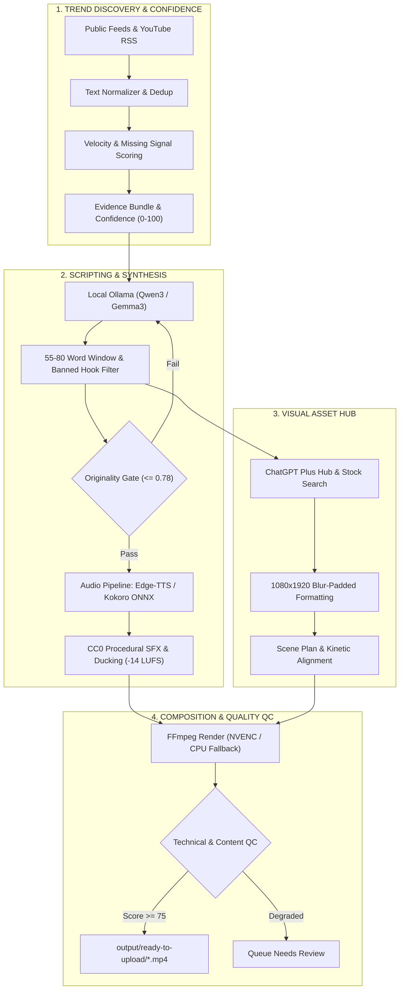

# LocalShorts Studio (`v0.1.0`)

<p align="center">
  
  
  
  
  
  
</p>

> **Free Local AI Shorts Factory**  
> *A local-first, zero-subscription desktop production engine for researching viral creator moments and generating ready-to-upload 1080×1920 YouTube Shorts automatically on consumer Windows laptops.*

---

## 📑 Table of Contents

1. [System Overview & Architecture](#-system-overview--architecture)
2. [Zero Mandatory Subscriptions](#-zero-mandatory-subscriptions)
3. [Key Features & Capabilities](#-key-features--capabilities)
   - [Google Stitch Dark Glassmorphic Interface](#1-google-stitch-dark-glassmorphic-interface)
   - [Whop Clipping 9:16 Card Grid & iPhone Player](#2-whop-clipping-916-card-grid--iphone-player)
   - [ChatGPT Plus Visual Asset Studio](#3-chatgpt-plus-visual-asset-studio)
   - [Free Online Neural Voiceovers (Edge-TTS)](#4-free-online-neural-voiceovers-edge-tts)
   - [Local LLM Scripting & Originality Gate](#5-local-llm-scripting--originality-gate)
   - [FFmpeg NVENC 1080×1920 Kinetic Pipeline](#6-ffmpeg-nvenc-10801920-kinetic-pipeline)
4. [Hardware Profiles & Safety Guardrails](#-hardware-profiles--safety-guardrails)
5. [Quickstart Guide](#-quickstart-guide)
   - [Prerequisites](#prerequisites)
   - [One-Click Launch](#one-click-launch)
   - [Running Diagnostics](#running-diagnostics)
6. [Core Workflows](#-core-workflows)
   - [Mode A: 1-Click Smoke Test](#mode-a-1-click-smoke-test)
   - [Mode B: Trend Discovery & Daily Batch Production](#mode-b-trend-discovery--daily-batch-production)
   - [Mode C: Custom Short Creation](#mode-c-custom-short-creation)
   - [Per-Stage Regeneration](#per-stage-regeneration)
7. [ChatGPT Plus Asset Hub Workflow](#-chatgpt-plus-asset-hub-workflow)
8. [Project Structure](#-project-structure)
9. [REST API Reference](#-rest-api-reference)
10. [Automated Testing & Verification](#-automated-testing--verification)
11. [Troubleshooting & FAQ](#-troubleshooting--faq)
12. [License & Attributions](#-license--attributions)

---

## 🏛 System Overview & Architecture

**LocalShorts Studio** is designed to produce up to **10 candidate Shorts/day** (~300 candidate Shorts/month) directly on personal hardware without recurring cloud fees. The entire pipeline operates through a deterministic, sequential worker queue that safeguards GPU VRAM and thermal margins on laptops.



---

## 💰 Zero Mandatory Subscriptions

LocalShorts Studio replaces expensive SaaS stacks with free local and open tools:

| SaaS Service | Typical Monthly Cost | LocalShorts Studio Replacement | Cost in Studio |
| :--- | :--- | :--- | :--- |
| **ElevenLabs / Paid TTS** | $22 – $99 / mo | **Free Edge-TTS** (8 Studio Neural Voices) + **Kokoro ONNX** | **$0.00 / Free** |
| **OpenAI / Claude API** | $20 – $100 / mo | **Local Ollama** (`qwen3:4b`, `gemma3:4b`) | **$0.00 / Free** |
| **Revid / Virlo / CapCut Pro**| $30 – $60 / mo | **FFmpeg NVENC 1080×1920 Kinetic Engine** | **$0.00 / Free** |
| **Runway / Video Gen** | $35 – $95 / mo | **Procedural Motion Plates + ChatGPT Plus Asset Hub** | **$0.00 / Free** |
| **Paid Trend Scrapers** | $49 / mo | **Free Public RSS + Google Trends + YouTube Feeds** | **$0.00 / Free** |
| **Total Monthly Spend** | **~$150 – $400 / mo** | **Local Hardware + Electricity + Internet** | **$0.00 / mo** |

---

## ✨ Key Features & Capabilities

### 1. Google Stitch Dark Glassmorphic Interface
Inspired by the **Google Stitch** (`stitch.withgoogle.com`) design system:
- **Obsidian Dark Canvas**: Deep `#080c14` background with translucent glass panels (`backdrop-filter: blur(16px)`).
- **Subtle Neon Glows**: Cyan (`#38bdf8`) primary accents and Emerald (`#10b981`) success indicators.
- **Live Telemetry Bar**: Real-time hardware telemetry display showing GPU temperature, thermal state, battery status, free disk space, and queue metrics.

### 2. Whop Clipping 9:16 Card Grid & iPhone Player
Inspired by creator clipping platforms like **Whop Clipping**, **Opus Clip**, and **SendShort**:
- **9:16 Vertical Short Cards**: Candidate Shorts are rendered as true vertical cards with thumbnail plate previews.
- **Hook Inspector**: The critical first 3-second hook is prominently highlighted in gold quotes on every card.
- **Quality Score Pill**: 0–100 score badge reflecting Hook strength, Clarity, Pacing, Originality, and Visual Diversity.
- **Dual View Switcher**: 1-click toggle between the **Whop 9:16 Card Grid** and the **Production Table** with automatic `localStorage` preference memory.
- **Interactive iPhone Preview Modal**: Floating 9:16 mobile frame with interactive video controls to inspect caption synchronization, audio levels, and visual pacing before publishing.

### 3. ChatGPT Plus Visual Asset Studio
Allows creators to leverage their existing personal ChatGPT Plus subscription (Web Search & DALL-E 3) without paying for third-party media APIs:
- **1-Click Prompt Generation**: Creates tailored prompts with exact scene timestamps, spoken lines, and visual search parameters.
- **Live URL Chip Parser**: Paste ChatGPT output; URLs are detected and mapped to scene tags (`✓ Scene 1`, `✓ Scene 2`).
- **Automatic 1080×1920 Re-composition**: Automatically transforms landscape/horizontal images into vertical plates using PIL with aesthetic Gaussian-blurred mirrored backdrops.
- **Free Stock Media Integration**: Built-in direct queries to Wikimedia Commons (CC-BY/Public Domain), Pexels, and Pixabay with attribution tracking.
- **Instant Re-render**: Re-composites scenes and triggers fast video re-rendering in under 10 seconds.

### 4. Free Online Neural Voiceovers (Edge-TTS)
- **8 Studio Voices**: Access high-fidelity Microsoft Edge Neural voices without API keys or subscriptions:
  - `en-US-ChristopherNeural` (Deep, authoritative documentary default)
  - `en-US-GuyNeural` (Punchy creator & tech explainer)
  - `en-US-JennyNeural` (Friendly conversational)
  - `en-US-AriaNeural` (Expressive narrative)
  - `en-US-EricNeural` (Casual explainer)
  - `en-GB-RyanNeural` (British documentary)
  - `en-GB-SoniaNeural` (British journalistic)
  - `en-AU-WilliamNeural` (Australian narrator)
- **Dynamic Speech Rate**: Configurable speed multiplier (default `1.05x`) for optimal retention.
- **4-Tier Fallback Audio Chain**: Edge-TTS -> Kokoro ONNX (82M) -> Windows SAPI / System.Speech -> Procedural DSP.
- **Kinetic Audio Mixer**: 5 CC0 procedural sound effects synthesized via NumPy (`impact.wav`, `whoosh.wav`, `pop.wav`, `click.wav`, `riser.wav`), audio ducking, and `-14 LUFS` loudness normalization.

### 5. Local LLM Scripting & Originality Gate
- **Ollama Engine**: Seamlessly communicates with local Ollama instances running `qwen3:4b`, `gemma3:4b`, or `qwen2.5:1.5b`.
- **Strict 55–80 Word Bounds**: Guarantees videos fit within the optimal 22–32 second retention window.
- **Banned Intro Filter**: Automatically strips generic greetings ("Hey guys", "Welcome back", "In this video").
- **3-Way Originality Verification**: Measures script overlap against source text using:
  1. RapidFuzz Token Sort / Levenshtein
  2. 3-Gram Jaccard overlap
  3. Scikit-learn TF-IDF Cosine Similarity
  *Scripts with $> 0.78$ similarity are automatically rejected and regenerated.*

### 6. FFmpeg NVENC 1080×1920 Kinetic Pipeline
- **Hardware NVENC**: Uses `h264_nvenc` with automatic CPU `libx264` fallback.
- **Kinetic Typography**: Word-level ASS/SRT subtitles with highlighted keywords (Yellow, Cyan, Emerald), text outlines, and drop shadows.
- **Visual Styles**:
  - `Creator News`
  - `Tech Explainer`
  - `Breaking Internet`
  - `Challenge`
  - `Minimal Documentary`
  - `High Energy`
- **Technical QC Gate**: Verifies MP4 container integrity, H.264 stream, AAC 48kHz audio, non-blank frames, audio energy presence, and caption synchronization.

---

## 💻 Hardware Profiles & Safety Guardrails

LocalShorts Studio dynamically inspects your system on startup and applies resource profiles tailored for laptops:

| Profile | System Requirements | Concurrency | Context | Encoder | TTS Engine |
| :--- | :--- | :--- | :--- | :--- | :--- |
| **LIGHTWEIGHT** | $\le 8\text{ GB}$ RAM, no NVIDIA GPU | 1 | 2048 | CPU `libx264` | Windows SAPI / DSP |
| **BALANCED** *(Default)* | **16 GB RAM, 4 GB VRAM (RTX 3050 Ti)** | **1** | **4096** | **`h264_nvenc` (CPU fallback)** | **Edge-TTS / Kokoro** |
| **PERFORMANCE** | $\ge 32\text{ GB}$ RAM, $\ge 8\text{ GB}$ VRAM | 1 | 8192 | `h264_nvenc` | Edge-TTS / Kokoro |

### 🛡 Laptop Protection Systems
1. **Thermal Guard**:
   - `< 80°C`: Normal operation.
   - `80°C – 85°C`: Inserts an automatic 10-second thermal rest between queue jobs.
   - `> 85°C`: Automatically pauses the queue until GPU temperature drops below 80°C.
2. **Battery Guard**:
   - When running on battery power, batch production is automatically paused to prevent sudden battery drain and thermal throttling. Can be overridden with 1 click in the UI.
3. **VRAM Collision Prevention**:
   - The LLM is explicitly unloaded from Ollama (`keep_alive: 0`) before FFmpeg GPU encoding starts. The 4 GB VRAM is never contested simultaneously by inference and rendering.

---

## 🚀 Quickstart Guide

### Prerequisites
1. **Windows 10 / 11 x64**
2. **Python 3.11** installed and on `PATH`
3. **Ollama** installed and running (`ollama serve`)
   ```powershell
   ollama pull qwen3:4b
   ```
4. **NVIDIA Driver** (optional, for NVENC hardware acceleration)

### One-Click Launch
In the repository root, double-click or run:
```cmd
START_LOCAL_SHORTS.bat
```
*The launcher will automatically bootstrap the isolated Python virtual environment (`.venv`), install dependencies, synthesize sound effects, start the local server on `http://127.0.0.1:8765`, and open your default browser.*

### Running Diagnostics
To verify your environment (FFmpeg, NVENC, Ollama, TTS, and rendering), run:
```cmd
DIAGNOSTICS.bat
```
Checks performed:
- [x] Python 3.11 virtual environment & dependencies
- [x] FFmpeg and ffprobe binary presence
- [x] NVENC hardware encoding capabilities with CPU fallback
- [x] Ollama API reachability & recommended model
- [x] Edge-TTS & Kokoro audio synthesizer
- [x] SQLite database in WAL mode
- [x] CC0 sound effects & fonts
- [x] Test render of a real 4.2-second 1080×1920 video with QC verification

---

## 🎬 Core Workflows

### Mode A: 1-Click Smoke Test
Click the **"⚡ 1-Click Smoke Test"** button in the top navigation bar. In ~20 seconds, the engine generates an original, verified Short:
- Topic: *Why Local AI Runs Without Sending Prompts to the Cloud*
- Includes narration, kinetic captions, zoom-pan effects, and sound effects.

### Mode B: Trend Discovery & Daily Batch Production
1. Open the **Dashboard** (`http://127.0.0.1:8765/dashboard`).
2. Click **"Scan Live Trends"** to scrape public RSS, Google News, and YouTube creator feeds.
3. Review ranked candidate topics with their **Source Confidence Score** (0–100).
4. Click **"Generate Selected"** or **"Run Full Daily Batch (10)"**.
5. The queue processes jobs sequentially. Approved videos are moved to `output/ready-to-upload/`.

### Mode C: Custom Short Creation
1. Go to **Create Short** (`http://127.0.0.1:8765/create`).
2. Enter your headline or topic (e.g., *How MrBeast Structures the First 5 Seconds of Every Video*).
3. Select your visual preset (`Creator News`, `Tech Explainer`, etc.) and caption preset (`Bold`, `Clean`, etc.).
4. Choose your voice (e.g., `en-US-ChristopherNeural`).
5. Click **"Queue & Render Short"**.

### Per-Stage Regeneration
If you like a script but want a different voice, caption style, or visuals, you don't need to re-run the entire pipeline. In the **Queue** (`/queue`), click:
- **Regen Script**: Rewrites the script with a fresh angle.
- **Regen Voice**: Re-records audio with another voice.
- **Regen Captions**: Re-styles kinetic subtitles without re-generating audio.
- **Regen Visuals**: Re-composites visual background plates.
- **Re-Render**: Fast re-mux and re-encode to MP4.

---

## 🎨 ChatGPT Plus Asset Hub Workflow

```
1. Click "ChatGPT Assets" on any Short in the Queue
                         ↓
2. Copy the generated prompt (Tab 1)
                         ↓
3. Paste into ChatGPT Plus (Web Search + DALL-E 3)
                         ↓
4. Copy ChatGPT's output & paste back into LocalShorts Studio
                         ↓
5. Studio auto-downloads, converts images to 1080x1920 (blur-padded),
   and automatically re-renders the final Short into READY state!
```

---

## 📁 Project Structure

```
localshorts-studio/
├── .venv/                      # Isolated Python 3.11 virtual environment
├── assets/
│   ├── fonts/                  # OFL kinetic caption fonts (Archivo Black, Barlow, Roboto)
│   └── sfx/                    # CC0 procedural sound effects (impact, whoosh, pop, click, riser)
├── bin/                        # Portable Windows binaries (ffmpeg.exe, ffprobe.exe)
├── cache/                      # Cached media plates and downloaded stock images
├── data/
│   ├── localshorts.db          # SQLite WAL database (Jobs, Trends, Settings, Scripts)
│   └── hardware_snapshot.json  # Last detected hardware profile
├── output/                     # Production output
│   ├── YYYY-MM-DD/{slug}/      # Complete project archive (video, audio, subtitles, QC)
│   └── ready-to-upload/        # Final QC-approved MP4 files ready for YouTube Shorts
├── src/localshorts/
│   ├── api/                    # FastAPI routes (health, generation, trends, settings, views)
│   ├── models/                 # Pydantic schemas and SQLModel tables
│   ├── services/               # Pipeline services
│   │   ├── audio_mixer.py      # CC0 audio ducking and LUFS normalization
│   │   ├── captions.py         # ASS/SRT kinetic subtitle builder
│   │   ├── confidence.py       # Source confidence & evidence scoring
│   │   ├── ffmpeg_builder.py   # FFmpeg command generator (NVENC / CPU)
│   │   ├── hardware.py         # Dynamic hardware profiler & thermal monitor
│   │   ├── media.py            # ChatGPT asset downloader & 1080x1920 blur padding
│   │   ├── ollama.py           # Ollama client with VRAM unload management
│   │   ├── originality.py      # 3-way originality verification gate
│   │   ├── qc.py               # Technical ffprobe QC inspector
│   │   ├── scene_planner.py    # Beat-by-beat scene timing planner
│   │   ├── scripting.py        # 55-80 word script generation & hook filter
│   │   ├── trends.py           # RSS scraper & trend clustering
│   │   └── tts.py              # Edge-TTS & Kokoro audio synthesizer
│   ├── ui/                     # Web interface
│   │   ├── static/             # CSS (Google Stitch theme) and JS (Whop UI logic)
│   │   └── templates/          # Jinja2 templates (dashboard, queue, create, settings)
│   ├── worker/                 # Sequential worker queue & pipeline executor
│   ├── config.py               # Configuration & directory paths
│   ├── database.py             # SQLite WAL engine & migrations
│   └── main.py                 # FastAPI application entrypoint & lifespan
├── tests/                      # Automated test suite
│   ├── integration/            # API, database, FFmpeg, and TTS integration tests
│   └── unit/                   # Captions, hardware, originality, security unit tests
├── BUILD_RELEASE.bat           # Release packager (ZIP + Setup.exe)
├── DIAGNOSTICS.bat             # 15-point system diagnostics script
├── START_LOCAL_SHORTS.bat      # One-click desktop launcher
├── pyproject.toml              # Project metadata & dependencies
└── README.md                   # System documentation
```

---

## 🔌 REST API Reference

The backend exposes a full REST API running on `http://127.0.0.1:8765`:

| Method | Endpoint | Description |
| :--- | :--- | :--- |
| `GET` | `/api/health` | Comprehensive system health, hardware status, and queue state |
| `GET` | `/api/status-bar` | Compact telemetry status bar for live UI updates |
| `GET` | `/api/jobs` | List all Shorts production jobs with optional status filter |
| `POST` | `/api/jobs` | Enqueue a new Short production job |
| `GET` | `/api/jobs/{id}` | Retrieve details, QC metrics, and scene plan for a job |
| `POST` | `/api/jobs/{id}/cancel` | Cancel an active or queued job |
| `POST` | `/api/jobs/{id}/regenerate-stage` | Re-run a specific stage (`script`, `tts`, `captions`, `visuals`, `render`) |
| `GET` | `/api/jobs/{id}/chatgpt-prompt` | Generate structured visual prompt for ChatGPT Plus |
| `POST` | `/api/jobs/{id}/import-chatgpt-assets` | Import URLs/text from ChatGPT Plus, re-composite scenes, and re-render |
| `GET` | `/api/media/stock-search` | Search free stock media across Wikimedia Commons, Pexels, and Pixabay |
| `POST` | `/api/trends/scan` | Trigger live scan of RSS and creator trends |
| `POST` | `/api/trends/generate-selected` | Enqueue Shorts from selected trend IDs |
| `GET` | `/api/settings` | Retrieve active system configuration and hardware profile |
| `POST` | `/api/settings` | Update settings (default voice, model, daily limit, speech rate) |

---

## 🧪 Automated Testing & Verification

LocalShorts Studio includes a full test suite covering all critical subsystems:

```powershell
# Run Ruff linter
.\.venv\Scripts\python.exe -m ruff check src tests

# Run full pytest suite
.\.venv\Scripts\python.exe -m pytest -v
```

### Test Coverage (32 / 32 Passed)
- **FastAPI Endpoints**: Health, status bar, settings, HTML views.
- **SQLite Database**: WAL mode, forward migrations, and crash recovery.
- **Live FFmpeg Render & QC**: Real 1080×1920 video render and ffprobe verification.
- **TTS Synthesis**: Edge-TTS online voices, Kokoro ONNX fallback, and audio mixer.
- **Captions & Typography**: Word-level emphasis, kinetic ASS/SRT formatting.
- **Source Confidence**: Domain authority, evidence bundles, and speculation penalties.
- **Originality Gate**: Token similarity and TF-IDF distance checks.
- **Security & Paths**: Path traversal blocking and URL SSRF protection.
- **Hardware & Safety**: Profile classification, thermal thresholds, and battery guard.

---

## ❓ Troubleshooting & FAQ

### 1. Ollama is not detected or says "Offline"
- Make sure Ollama is installed and running:
  ```powershell
  ollama serve
  ```
- Test connectivity:
  ```powershell
  curl http://127.0.0.1:11434/api/tags
  ```
- Ensure the recommended model is downloaded:
  ```powershell
  ollama pull qwen3:4b
  ```

### 2. FFmpeg NVENC error on older hardware
- If your system does not have an NVIDIA GPU or lacks NVENC support, the engine automatically falls back to CPU encoding (`libx264`).
- You can manually force CPU encoding in **Settings** (`/settings`) under **Rendering Options**.

### 3. Voice generation fails when offline
- Edge-TTS requires an internet connection for Microsoft's free neural voices.
- If you are offline, LocalShorts Studio automatically switches to **Kokoro ONNX** or **Windows SAPI / System.Speech** so you can continue rendering completely offline.

### 4. Video shows blurred sides around images
- This is intentional! YouTube Shorts require a vertical `9:16` (`1080×1920`) aspect ratio. When horizontal `16:9` images are imported from ChatGPT or stock sources, the engine pads them with a blurred mirrored backdrop instead of adding ugly black bars or cropping out crucial parts of the image.

---

## 📜 License & Attributions

- **LocalShorts Studio**: Licensed under the [MIT License](LICENSE).
- **Procedural Audio**: The 5 sound effects in `assets/sfx/` (`impact.wav`, `whoosh.wav`, `pop.wav`, `click.wav`, `riser.wav`) are synthesized mathematically using NumPy and dedicated to the **Public Domain (CC0 1.0 Universal)**.
- **Kinetic Fonts**: `Archivo Black`, `Barlow Condensed`, and `Roboto Condensed` are licensed under the **SIL Open Font License (OFL) / Apache 2.0**.
- **Icons & Theme**: Google Stitch and Whop Clipping design patterns utilized under fair-use creator tool styling guidelines.
